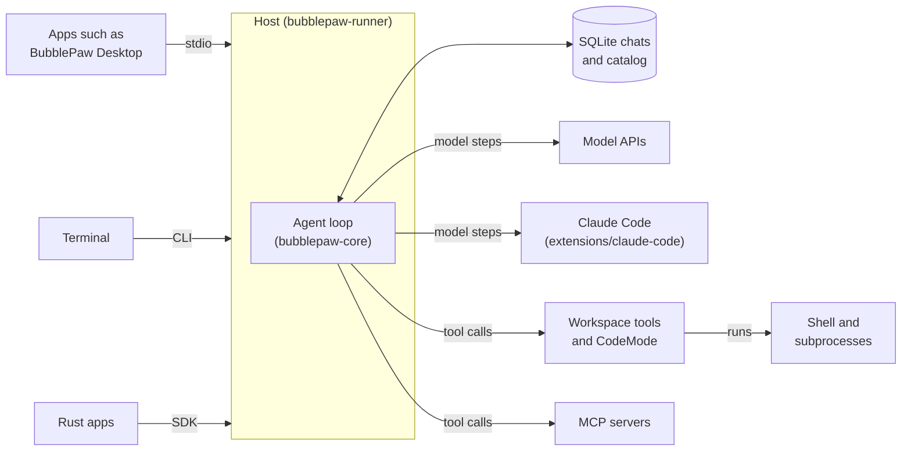

<p align="center">
  <picture>
    <source media="(prefers-color-scheme: dark)" srcset="design/readme/bubblepaw-dark.svg">
    
  </picture>
</p>

<p align="center">
  A small, library-first Rust agent harness. The core supplies a model/tool loop,
  SQLite sessions, paragraph/action events, steering, follow-ups, cancellation and
  explicit resume. The runner supplies model adapters and ordinary workspace tools.
</p>

## What it is

- **Agent loop.** A model and tool loop with steering, follow-ups, cancellation and explicit resume. One run is active per session, and separate sessions can run at the same time.
- **SQLite chats.** Complete messages, queued inputs and external-effect checkpoints persist in SQLite files under a central data directory. Streamed fragments stay transient. An interrupted effect is reported as unknown and is never replayed automatically.
- **Approvals.** Tool calls pass an approval gate in `ask`, `allow`, `deny` or `auto` mode.
- **Summarization.** When the estimated context nears its limit, older history is summarized, and the original archive stays intact.
- **MCP client.** Connects to external MCP servers over stdio and Streamable HTTP. Every MCP tool call is a durable, approval-gated effect. The runner exposes no MCP server.
- **Providers and extensions.** The runner ships Codex (the default), an OpenAI API provider and an offline `demo` provider. A Bun extension in `extensions/claude-code` drives Claude Code one model step at a time.
- **Host API and SDK.** One method table sits behind the stdio, HTTP, CLI and Rust SDK front ends. Rust embedders use `bubblepaw-sdk`.

## How it fits together



Apps reach the host in one of three ways: BubblePaw Desktop starts it as a child and talks JSON-RPC over stdio, the CLI runs inside it, and Rust apps embed it through `bubblepaw-sdk`. The host runs each chat through the agent loop in `bubblepaw-core`, which stores every accepted input and finished message in SQLite. Each step asks a model for its next move, then runs the tools it calls: workspace tools, CodeMode or MCP servers (through `bubblepaw-mcp`). Child processes run in owned process trees (`bubblepaw-process`). `bubblepaw-remote` is a library for paired devices; nothing uses it yet.

| Crate | Path | What it does |
| --- | --- | --- |
| `bubblepaw-core` | [crates/bubblepaw-core](crates/bubblepaw-core) | The library: a native agent loop with durable SQLite history and effects, transient presentation, approvals and context preparation. It has no provider, file-tool or product code. |
| `bubblepaw-runner` | [crates/bubblepaw-runner](crates/bubblepaw-runner) | The `bubblepaw` binary and its library: provider adapters, workspace tools, CodeMode and the optional web host. Features: `web`, `bench`, `test-fixtures`. |
| `bubblepaw-mcp` | [crates/bubblepaw-mcp](crates/bubblepaw-mcp) | The host-owned MCP client over stdio and Streamable HTTP. |
| `bubblepaw-process` | [crates/bubblepaw-process](crates/bubblepaw-process) | The process-tree helper. Each child starts in an owned tree: a process group on Unix, a kill-on-close job object on Windows. |
| `bubblepaw-sdk` | [crates/bubblepaw-sdk](crates/bubblepaw-sdk) | Re-exports the core surface for Rust embedders and adds `HostBuilder`. |
| `bubblepaw-remote` | [crates/bubblepaw-remote](crates/bubblepaw-remote) | Paired device identities, encrypted transport and a metadata-only relay. Library only; runner wiring is deferred. |
| `bubblepaw-claude-code` | [extensions/claude-code](extensions/claude-code) | Bun provider extension that drives Claude Code one model step at a time. |

The project documentation is in [`docs/`](docs/). Its index is [docs/README.md](docs/README.md).

## Build

### Requirements

- Rust 1.88 or newer (`rust-version` in the workspace `Cargo.toml`; edition 2024).
  Install with [rustup](https://rustup.rs).
- Linux and Windows, with Git to clone the repository. macOS is untested.
- A provider: a Codex login (the default), an OpenAI API key, or the offline
  `demo` provider.

### Compile

```sh
git clone https://github.com/BubbleBuffer/BubblePaw-Core
cd BubblePaw-Core
cargo build --release --bin bubblepaw
```

```powershell
git clone https://github.com/BubbleBuffer/BubblePaw-Core
cd BubblePaw-Core
cargo build --release --bin bubblepaw
```

The `cargo` commands are the same in `sh` and PowerShell. The binary is
`target/release/bubblepaw` on Linux, and `target\release\bubblepaw.exe` on
Windows. `cargo build --release` does not build the test fixtures.

The optional web workbench is a feature of `bubblepaw-runner`:

```sh
cargo build --release -p bubblepaw-runner --features web --bin bubblepaw
```

```powershell
cargo build --release -p bubblepaw-runner --features web --bin bubblepaw
```

The `chapter-bench` and `replay` commands need `--features bench`.

### Checks

CI (`.github/workflows/ci.yml`) runs on GitHub-hosted runners for every pull request
and every push to `main`. It installs the stable toolchain with
`rustup toolchain install stable --profile minimal -c rustfmt,clippy`, then runs:

```sh
cargo fmt --all --check
cargo clippy --workspace --all-targets --locked -- -D warnings -A deprecated
cargo clippy -p bubblepaw-runner --features web,bench --all-targets --locked -- -D warnings -A deprecated
cargo test -p bubblepaw-core -p bubblepaw-mcp -p bubblepaw-process -p bubblepaw-sdk --locked --no-fail-fast
cargo test -p bubblepaw-runner --locked --no-fail-fast
cargo test -p bubblepaw-runner --features web,bench --locked --no-fail-fast
```

The Linux job runs all of these. The Windows job runs the core, MCP, process and SDK
test command and the `web,bench` runner test command. The extension job runs, in
`extensions/claude-code` with Bun 1.3.14:

```sh
bun install --frozen-lockfile
bun run typecheck
bun test
```

The same Rust commands work in PowerShell. Pushing a `v*` tag builds `bubblepaw` for
Linux and Windows, with and without the `web` feature, and attaches the archives to a
GitHub release (`.github/workflows/release.yml`). macOS is not tested. See
[verification](docs/verification.md) for how the project is checked and
[decisions](docs/decisions.md) for the agreed boundaries.

`cargo test` builds the test fixture binaries (the fake extension and fake MCP
servers) automatically: the runner and MCP crates enable their `test-fixtures`
feature for their own dev-dependencies. `cargo build --release` does not include
them.

Focused tests exercise real archive reopen, durable queues, interrupted effects,
custom tools, stream write counts, local mock provider transport and actual native
processes.

## Run

Use the existing Codex authentication file. The adapter reads it and never prints
it. The default is `$CODEX_HOME/auth.json`, else `~/.codex/auth.json` (on Windows,
`%USERPROFILE%\.codex\auth.json`). Override the path with `--auth-file`.

```sh
./target/release/bubblepaw --workspace /path/to/project run "Inspect this project and explain its next useful change."
```

```powershell
.\target\release\bubblepaw.exe --workspace C:\path\to\project run "Inspect this project and explain its next useful change."
```

The default provider is `codex`, with model `gpt-6-luna`. Choose another model
using `--model`.

For an OpenAI API key, set `OPENAI_API_KEY` and pass `--provider api`. For an
explicit offline demo, use `--provider demo`. The writable demo lists the
workspace, creates a uniquely named demo file, reads it and runs a short process.
It is a deterministic fixture, not an offline language model.

```sh
./target/release/bubblepaw --provider demo --workspace /path/to/sandbox run "Exercise the tools."
./target/release/bubblepaw --read-only --workspace /path/to/project run "Review the code."
```

```powershell
.\target\release\bubblepaw.exe --provider demo --workspace C:\path\to\sandbox run "Exercise the tools."
.\target\release\bubblepaw.exe --read-only --workspace C:\path\to\project run "Review the code."
```

The runner prints the session ID to stderr. Continue the same session in a fresh
process with `run --session ID "Continue the work."`. Use `resume ID` to explicitly
continue interrupted/pending work. `sessions`, `history ID` and `stats` inspect the
archive without contacting a provider. `--json` emits structured progress and
the final result. Ctrl+C cancels current work.

## Commands

Run `bubblepaw --help` for every flag. Commands marked with a feature exist only
in a build with that feature.

| Command | Purpose |
| --- | --- |
| `config` | Print the effective configuration and where each value came from. |
| `run` | Run a prompt. `--session ID` continues a session, `--name` titles a new one, `--no-session` uses a temporary store. |
| `script` | Run a JS file as a model-less run and print its result. |
| `resume` | Explicitly continue interrupted or pending work. |
| `stdio` | JSON-RPC 2.0 over stdin and stdout, with no HTTP server. See [Process interface](#process-interface). |
| `sessions` | List saved sessions without contacting a provider. |
| `history` | Print the authoritative conversation of a session. |
| `export` | Export one session as JSONL, with complete message content and child links. |
| `usage` | Usage and cost by session, model, provider and day, from retained records. |
| `usage export` | One JSONL line per request (`bubblepaw.usage.v1`). |
| `login` | Sign in to a provider console that quota is read from. Only `login opencode` exists. |
| `logout` | Delete a stored console login. |
| `quota` | Latest subscription and rate-limit readings, without contacting providers. |
| `quota export` | Change-only quota history as `bubblepaw.quota.v1` JSONL. |
| `import` | Import a local Claude Code or Codex transcript without contacting a provider. |
| `archive` | Compress a whole idle chat, including its child sessions. |
| `unarchive` | Restore an archived chat to its ordinary SQLite file. |
| `search` | Search indexed text across chats. |
| `delete` | Delete a session and its descendants. Deleting a root removes its chat file. |
| `catalog rebuild` | Rebuild the session catalog from the authoritative chat files. |
| `serving wipe` | Wipe the disposable serving projection. |
| `stats` | Archive size and write counters. |
| `trace-report` | Summarize a JSONL behavior trace without contacting a provider. |
| `delegate` | Run one delegated assignment (Markdown with TOML front matter). |
| `delegations report` | Cost per accepted outcome by category, class, model and route reason. |
| `chapter-bench` | (feature `bench`) Compare chapter selection on recorded chats without executing their tools. |
| `replay` | (feature `bench`) Replay a recorded chat into a fresh isolated archive and report. |
| `web` | (feature `web`) Serve the local workbench. `--assets` is required; `--port` defaults to 8788. |

## Web search

Enable native web access with `--web`. This adds `web_search`, `web_fetch` and
the visible `research` child profile on the ordinary agents path. `--web-expose
fetch,search` selects which of the two tools the parent gets. Research children
inherit the parent's active run model and support follow-ups in the same saved
session. Both tools share a disposable SQLite cache and persisted chat source IDs.
See [web tools and agent profiles](docs/web.md) for configuration, embedding and
address safety.

Search backends are tried in the order of `web.search`, which defaults to
`["deepseek", "ddg"]`. DeepSeek is skipped when `DEEPSEEK_API_KEY` is unset (the
variable named by `web.deepseek_key_env`). DuckDuckGo (`ddg`) needs no setup, so
search works with no keys at all. `--web-search <backend>` sets one backend
instead: `searxng:<url>`, `brave` (reads `BRAVE_API_KEY`), `deepseek` or `ddg`.
For an ordered list on the command line, use
`--set 'web.search=["deepseek", "ddg"]'`.

## Configuration

Settings are layered; later layers win:

1. Built-in defaults.
2. The user file, `~/.bubblepaw/config.toml`.
3. The project file, `<workspace>/.bubblepaw/config.toml`.
4. Environment variables, `BUBBLEPAW_` plus the key path in upper case
   (for example `BUBBLEPAW_CONTEXT__STRATEGY`).
5. CLI flags, including `--set <key.path>=<value>` for any key.

`--config <file>` (or the `BUBBLEPAW_CONFIG` variable) replaces the user and
project files with one known file, so a run depends on that file alone.
`bubblepaw config` prints the effective configuration and where each value came from.

The annotated example is [`docs/config.example.toml`](docs/config.example.toml).
Copy it to `~/.bubblepaw/config.toml` or `<workspace>/.bubblepaw/config.toml`,
or pass it with `--config`. Keep credentials out of the file; they come from
environment variables or the auth file. For the full key reference, see
[configuration](docs/config.md).

```sh
./target/release/bubblepaw --config docs/config.example.toml config
```

```powershell
.\target\release\bubblepaw.exe --config docs\config.example.toml config
```

## Data directory

BubblePaw keeps one central store per user and machine. It holds the chats of
every project; each root chat records its own workspace. The base directory is
the first of `LOCALAPPDATA`, `XDG_DATA_HOME` and `HOME` that is set (on macOS,
`HOME/Library/Application Support` in place of `HOME/.local/share`). The store is
`BubblePaw-Core/store` inside it:

| OS | Default store |
| --- | --- |
| Windows | `%LOCALAPPDATA%\BubblePaw-Core\store` |
| Linux | `$XDG_DATA_HOME/BubblePaw-Core/store`, or `~/.local/share/BubblePaw-Core/store` |
| macOS | `~/Library/Application Support/BubblePaw-Core/store` (unless `LOCALAPPDATA` or `XDG_DATA_HOME` is set) |

A store from before the rename (`BubblePaw-base/store` in the same base directory) is imported once on first start; the old folder is only read.

The directory holds `catalog.db`, a disposable `serving.db`,
`chats/<root-session-id>.db` and `store.lock`. The first process to take the lease
hosts the store, and later `run` and `delegate` processes attach to it.

`--data-dir <directory>` (or `--set storage.data_dir=<directory>`) selects another
store. That store is isolated and never imports legacy data, which suits tests and
benchmarks. `--db <file>` is a legacy alias for an old single-file archive: it is
migrated once into a sibling `<stem>.data` directory, and the original file is kept.
`--db` and `--data-dir` cannot be combined. See
[storage model](docs/storage-model.md) for the layout and limits.

```sh
./target/release/bubblepaw --data-dir /path/to/store run "Continue the work."
```

```powershell
.\target\release\bubblepaw.exe --data-dir C:\path\to\store run "Continue the work."
```

## Local web workbench

`web` serves a local workbench from this process, with the harness embedded
directly. It needs the `web` feature and a built frontend: the directory given
with `--assets` (required; it must contain `index.html`). That frontend is not
part of this repository and is not published yet, so this repository provides the
server only. The frontend's [product brief](docs/product.md) and
[visual design](docs/design.md) are in `docs/`.

```sh
./target/release/bubblepaw --workspace /path/to/project web --port 8788 --assets /path/to/frontend/dist
```

```powershell
.\target\release\bubblepaw.exe --workspace C:\path\to\project web --port 8788 --assets C:\path\to\frontend\dist
```

Open `http://127.0.0.1:8788`. The server binds to loopback only. It is a local
workbench, not a remote deployment or account/login service.

The web host enforces a prompt cap of 32,000 Unicode characters
(`--max-prompt-chars`). Uploads are capped at 16 MiB per file
(`--max-attachment-bytes`), 32 MiB per message (`--max-attachment-total-bytes`)
and 16 files per message. Uploads are immutable workspace files under
`.run/attachments/`; files above 4 KiB are also stored as SQLite blobs. Attachment
text and reference metadata share a 10,000-token O200k estimate
(`--attachment-inline-tokens`). Larger text and binary files are referenced by
path for tools to read. Reading a supported image attaches it to the model request
within the image caps. The CLI and stdio also enforce the prompt cap. Stored files
have no automatic retention cleanup yet, including uploads from abandoned drafts.

New chats default to native tools: core capabilities plus `tool_search` and
`call_tool`, without `js`. Use `--set agent.execution_mode=js` for the opt-in
JavaScript wrapper, which declares only `js`. Both modes share native
implementations, schemas, approvals and the effect journal. Chats retain their
mode on resume; legacy chats without a stored mode use JS.

In opt-in JS mode, native commands, files and environment controls are methods
inside its JS API, with a short reference in the tool description.
JS expressions return their value to the model; multi-statement cells use
explicit `return`. `text(markdown)` deliberately publishes Markdown to the user.
Each JS result defaults to a 10,000-token O200k estimate, including receipts and
state notices. `maxOutputTokens` changes the per-call budget. Oversized results
return an explicitly marked preview and a workspace-local full-output file;
truncation preserves the REPL state. The 60 KiB model-reply byte limit also applies.
State changes/reset produce compact model-context notices. `state.reset()` clears
saved state data in the current cell. Independent reads/checks are encouraged to
run together in JS batches, reducing model round trips.
`tools.agent({task, context, profile})` starts a child with separate history/state.
The default profile is `read-only`; `workspace` is available to writable hosts
and `research` when web access is enabled. `wait({handle})` retrieves its final answer; the parent
can publish it with `text(result.text)`. Explicit workspace access, cancellation
and background waits use the same JS API. Saved child chats use ordinary sessions;
orchestration stays in the runner above the core harness.
The runner includes QuickJS CodeMode, named execution environments and
explicit Markdown/file/image outputs. Existing archived outputs remain readable.
See [CodeMode](docs/codemode.md) for the API and limits.
In opt-in JS mode, experimental `cmd` tags preserve native argument boundaries.
Optional behavior traces record model/tool metrics or bounded deep contents without adding archive
writes; see [tracing and reports](docs/tracing.md).

The server embeds the library directly, with no worker subprocess or separate
agent loop. An in-memory SQLite serving view holds bounded presentation data;
canonical history remains in the archive. Progress paragraphs stay in bounded RAM
and cause no database writes. Reconnecting refreshes saved state rather than
replaying a durable stream log.

Use `--read-only` for review-only workspace tools or `--provider demo` for an
explicit scripted fixture. The web dependencies are optional; ordinary CLI and
library builds do not need the frontend or server feature.

## Embed

`bubblepaw-core` is independent of the runner, network provider, file tools and
BubblePaw product code. Implement `Provider` and `Tool`, register your tools in a
`ToolRegistry` (native host capabilities go in with `ToolRegistry::register_host`),
then construct `Harness::new(store, provider, tools, config)`. Core capabilities are
declared directly in the default native mode. To opt into JS, register the runner's
`CodeMode` adapter and set `HarnessConfig.execution_mode` to `ExecutionMode::Js`.
The core remains independent of JavaScript.
`Store::in_memory()` is
available for ephemeral applications; `Store::open(path)` provides durability.
Outside programs can take one dependency, `bubblepaw-sdk`, which re-exports this
surface and adds `HostBuilder`; see [the Rust SDK](docs/sdk.md).

`Harness::effective_tool_definitions(session_id, &options)` gives an embedder the
same initial tool declarations as a model turn, including session/run
restrictions and generated help in opt-in JS mode. Async
`Harness::call_tool(session_id, name, arguments, options, cancellation)` returns
`ToolResult` without a model turn, using ordinary
session admission, validation, approvals, cancellation and durable dispatch.
An approval requiring an interactive decision fails clearly. See
[execution modes and embedder APIs](docs/codemode.md).

`prompt()` waits for the session to settle, including accepted automatic followups.
`start()` returns after durable admission and executes asynchronously. Subscribe
before starting if progress matters. One run is active per session; separate
sessions can run concurrently. Tool calls execute sequentially. Steering applies
after the current assistant/tool round; cancellation interrupts current work.
Inside CodeMode, host calls can run concurrently. Steering releases an explicit
foreground wait into the background, preserving its original environment and
continuation; another environment can investigate while it is pending.
Failed/cancelled work leaves pending inputs available for explicit resume.

`ContextPreparation` is a small replaceable hook with a full-history library default.
The runner enables readable automatic summarization, while keeping the original
archive intact. A summary is triggered when the estimated context reaches
`min(W, 200,000) - 16,000` tokens, where `W` is the model's context window when it
is known, and 200,000 otherwise. With an unknown window the trigger is 184,000.
The 200,000 cap is `context.compact_threshold_tokens` (CLI
`--compact-threshold-tokens`). The 16,000-token output reserve,
`context.lcm.output_reserve_tokens`, is subtracted from the cap as well as from
the window. Child sessions use `context.lcm.child_compact_threshold_tokens`
(100,000) as their cap. The summary request is sent to the same model with tools
disabled. A saved checkpoint replaces only the older prefix in subsequent model
requests; recent messages and the latest user request remain available. Tool calls
and their results stay together.

The runner reads `W` from local Codex metadata, or accepts
`--context-window-tokens N`. If `W` is unknown, the 200,000-token cap applies;
set the window explicitly for smaller models. `--no-auto-summarize` disables
automatic preparation. Counts use an O200k token estimate calibrated by each
provider response's input/output usage, not cumulative run totals; opaque
reasoning and model-specific framing remain estimated. The serialized byte guard
remains in force.

After summarization, a small regenerated note lists current REPL generations and
saved key names, owned commands and child-agent statuses. Values and command/child
outputs are excluded. Runtime state is volatile; restarting reloads the saved
checkpoint and accurately reports the fresh runtime. Failed, cancelled, oversized
or timed-out summaries leave the previous checkpoint unchanged and fail the run
with a diagnostic. See [the prompt](crates/bubblepaw-runner/src/summary_prompt.md).

## Process interface

`bubblepaw stdio` accepts bidirectional JSON-RPC 2.0 records, one record per line.
Stdout contains protocol only; stderr is for diagnostics. The process runner is
optional: embedding the Rust library requires no process boundary.

```json
{"jsonrpc":"2.0","id":1,"method":"session.open","params":{"title":"Work"}}
{"jsonrpc":"2.0","id":2,"method":"run.start","params":{"session_id":"SESSION_ID","text":"Read README.md"}}
```

Methods, grouped (24 in all):

- Host: `initialize`, `config.reload`, `storage.stats`, `shutdown`
- Sessions: `session.open`, `session.list`, `session.state`, `session.rename`,
  `session.rewind`, `session.compact`, `session.delete`
- Events: `events.after`
- Runs: `run.start`, `run.resume`, `run.steer`, `run.follow_up`, `run.cancel`
- Environments and processes: `environment.inspect`, `environment.control`,
  `process.list`, `process.background`
- Approvals and questions: `approval.list`, `approval.decide`, `question.answer`

Tool calls that wait for a person are described in [approvals](docs/approvals.md).
Several clients watching and driving one session (snapshot, durable event log,
catch-up, client origin) are described in the [session API](docs/session-api.md),
which is the reference for every method's parameters.
Notifications use method `event`; `run_finished` differs from `session_settled`
when queued work follows. `events.gap` tells a client it missed events.
`run.start` acknowledges durable admission, not completion.
On an `events.gap` notification, reconstruct state with `session.state`.
The wire contract is provisional. Host tools currently extend the Rust library;
remote tool registration/callbacks are not implemented. The separate optional
web host exposes the HTTP/SSE contract in [web-contract](docs/web-contract.md).

## Storage and resource limits

SQLite stores complete messages, queued inputs and external-effect checkpoints.
Streamed token fragments, paragraph events and process-output chunks are transient.
Consumed input text and final run text are not duplicated beside canonical history.
Tool results are capped at 64 KiB by default. Process capture is bounded, with
host-owned handles and an optional explicit command deadline. An explicit wait
does not impose a command deadline. The host calls `ProcessTools::shutdown()`.
Running operations keep an effect boundary open until actual termination.
Explicit cell outputs are durable JSON references; captured artifact bytes live
beside the archive. Heaps in opt-in JS mode, stream fragments, polling and state
previews are not checkpointed. Older stores and archives upgrade to the current
schema on first open. A store whose schema version is newer than this build
supports is refused with `Unsupported database schema version`.
Context checkpoints use one bounded row per session, replaced in one transaction only when summarization
succeeds; no extra history copies or per-token writes are added.

Interrupted dispatched effects receive an explicit unknown-outcome result and are
never automatically replayed. This does not provide exactly-once external effects
or automatic undo of file/process changes.

`stats` reports database/page/WAL bytes and message/pending-input counts. Its
transaction counter is process-local and counts successful runtime transactions,
not every filesystem write or schema-initialization operation. SQLite uses FULL
durability and a 256-page automatic WAL checkpoint threshold. The threshold is not
a hard WAL size limit when readers keep snapshots open.

The web host owns the disposable in-memory serving projection. The core exposes
coherent bounded snapshots, without depending on the serving schema or UI.

## Current limits

- Live-model acceptance has run on OpenCode Go (Messages, chat, Responses) and
  OpenRouter (chat, Responses); see [provider qualification](docs/provider-qualification.md).
  Direct OpenAI, direct Anthropic, direct chat completions and the Claude Code
  extension have no live run there. BubblePaw never refreshes Codex OAuth tokens;
  the Codex CLI owns refresh.
- `read` sends PNG, JPEG, GIF and WebP images to models that accept image input,
  including reads inside opt-in `js`; count and size caps apply. Automatic
  inclusion of presentation artifacts in model context remains deferred.
- Readable summarization triggers on an estimated O200k token count, with a byte
  guard. Context episodes replace chapters for new compactions; provider-native
  opaque compaction is deferred.
- Processes use pipes with closed stdin; no interactive PTY. Execution uses host
  permissions. Windows exec puts each command in a kill-on-close job object; Unix
  uses a process group.
- File tools enforce canonical workspace paths and compare-and-swap edits; these
  checks are not an adversarial filesystem sandbox.
- Child sessions are long-lived ([child sessions](docs/child-sessions.md)). MCP is
  client-only over stdio and Streamable HTTP; the runner exposes no MCP server.
- Skill catalogs are discovered from the workspace and user skill directories and
  frozen per session; see [skills](docs/skills.md).
- Inline provider setup saves and applies provider changes live. Disk edits apply
  at the next turn start, or on demand through `config.reload` over stdio
  ([live config](docs/live-config.md)).
- REPL state is volatile; failed/cancelled
  cells reset their environment and report a new generation. No heap replay.

## License

BubblePaw-Core is licensed under the GNU Affero General Public License, version 3
only (`AGPL-3.0-only`). See [LICENSE](LICENSE).

The exception is `extensions/claude-code`, which is MIT licensed (its
`package.json` says so). Its [NOTICE](extensions/claude-code/NOTICE) credits the
adapted pi-claude-bridge code, which is also MIT. The extension has no LICENSE file
of its own.

BubblePaw is made by [BubbleBuffer](https://0xbubbuff.de).
